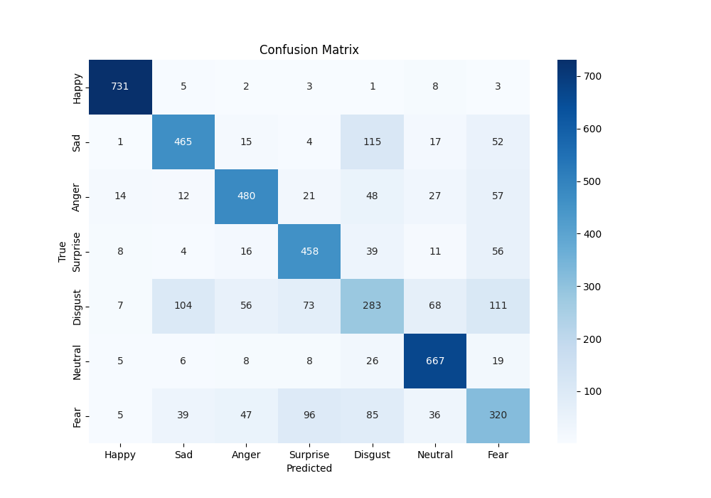
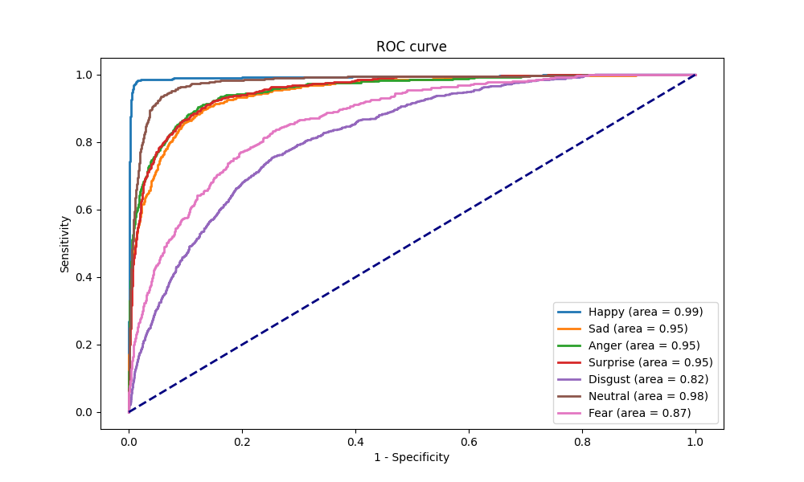

# 🎭 Facial Emotion Recognition using Multi-Input Deep Learning

**Multi-input CNN for Korean facial emotion classification**
Undergraduate research project, Ewha Womans University (2023–2025)

  

## 📌 Overview

The model classifies 7 emotions from a face image. It fuses three inputs:

1. **Image**: 64×64 grayscale face crop
2. **Landmarks**: 101 key MediaPipe FaceMesh points (x, y, z → 303 features)
3. **Z-features**: 8 geometric ratios between landmark distances, expanded to 56 features

The best model, **Image + Landmark + Z**, reaches **71.8% accuracy, macro F1 0.707 and ROC-AUC 0.930** on a held-out test set of 4,742 images. That beats an image-only CNN (69.5%) and ImageNet-pretrained backbones (≤ 65.0%).

The project was originally motivated by expression-feedback tools for people with alexithymia.

## 🎯 Emotion Classes

| Label | Emotion |
|---|---|
| 0 | Happy |
| 1 | Sad |
| 2 | Anger |
| 3 | Surprise |
| 4 | Disgust |
| 5 | Neutral |
| 6 | Fear |

## 📊 Dataset

- **Source:** AI Hub Korean emotion image dataset (한국인 감정인식을 위한 복합영상)
- **Split:** each emotion was split 75 / 15 / 10 (train / val / test). Only the training set was then augmented offline, with one augmented copy per original image, which doubled it.
- **Final sizes:** Train 71,002 · Val 7,099 · Test 4,742 (total 82,843). Images whose landmarks could not be extracted were dropped.

| Emotion | Train | Val | Test |
|---|---|---|---|
| Happy | 11,251 | 1,123 | 753 |
| Sad | 10,058 | 1,003 | 669 |
| Anger | 9,863 | 986 | 659 |
| Surprise | 8,858 | 887 | 592 |
| Disgust | 10,485 | 1,049 | 702 |
| Neutral | 11,051 | 1,106 | 739 |
| Fear | 9,436 | 945 | 628 |

The data is stored as TFRecord:

```python
features = {
    "image":     tf.io.FixedLenFeature([], tf.string),   # JPEG-encoded face crop
    "landmarks": tf.io.VarLenFeature(tf.float32),        # 468 x 3 FaceMesh landmarks
    "label":     tf.io.FixedLenFeature([], tf.int64),    # 0-6
    "z_values":  tf.io.FixedLenFeature([8], tf.float32), # 8 distance ratios
}
```

## 🔧 Preprocessing Pipeline

1. **Face detection and alignment.** MediaPipe Face Detection (confidence 0.2) finds the face. The image is rotated so the eyes are level, then cropped and resized to 64×64 grayscale.
2. **Split.** Each emotion is split 75 / 15 / 10.
3. **Augmentation (train only).** `ImageDataGenerator` with rotation 5°, zoom 0.05, shift 0.05, horizontal flip and brightness 0.8–1.2. One augmented copy is made per image.
4. **Landmarks.** MediaPipe FaceMesh gives 468 points. 101 key points are kept from the eyebrows, eyes, inner and outer lips, nose and nose bridge, giving 303 values.
5. **Z-features.** These are not depth values. They are 8 scale-invariant ratios of Euclidean distances between landmark pairs (z1, z2, z3, z5–z9), for example:
   ```python
   z1 = dist(lm[78], lm[308]) / dist(lm[14], lm[13])    # mouth width / mouth opening
   z2 = dist(lm[33], lm[133]) / dist(lm[160], lm[144])  # eye width / eye opening
   ```
   The 8 ratios are expanded into 56 features by taking the product of every 3-combination:
   ```python
   z_combinations = list(itertools.combinations(range(8), 3))  # C(8,3) = 56
   z_feat = [tf.reduce_prod(tf.gather(z, list(c))) for c in z_combinations]
   ```

## 🏗️ Model Architecture

```
Image (64×64×1)                     Landmarks (303)            Z-features (56)
  Conv64-BN-ReLU-MaxPool-Drop0.2      Dense101                   Dense101
  Conv128-BN-ReLU-MaxPool-Drop0.2     Dense64                    BN → ELU
  Residual block ×3 (Conv256×2,       Dense32                    Dropout 0.2
    1×1 projection shortcut)          (BN, ELU, Dropout 0.3)
  MaxPool, Conv512×2, MaxPool,
  Dropout 0.5, Flatten
          └──────── Concatenate ────────┘                            │
                         └──────────── Concatenate ─────────────────┘
                                   Dense128 → BN → ELU → Dropout 0.5
                                   Dense7 → Softmax
```

The model has 8,152,124 parameters in total.

## ⚙️ Training Configuration

```python
seed = 42
epochs = 100
batch_size = 32
learning_rate = 5e-4
optimizer = "Adam"  # TODO: verify (the saved model reports RMSprop)

loss = focal_loss(gamma=2.0, alpha=0.25)
callbacks = [
    EarlyStopping(patience=10, restore_best_weights=True),
    ReduceLROnPlateau(factor=0.5, patience=5, min_lr=1e-6),
]
# L2 regularization on hidden layers; dropout 0.2–0.5
```

## 🧪 Results (test set, n = 4,742)

### Input combinations and baselines

| Model | Accuracy | Precision | Recall | F1 | ROC-AUC |
|---|---|---|---|---|---|
| **Image + Landmark + Z (proposed)** | **0.718** | **0.705** | **0.712** | **0.707** | **0.930** |
| Image + Landmark | 0.707 | 0.696 | 0.701 | 0.695 | 0.926 |
| Image + Z | 0.705 | 0.701 | 0.699 | 0.696 | 0.927 |
| Image only | 0.695 | 0.677 | 0.687 | 0.674 | 0.923 |
| Z only | 0.499 | 0.468 | 0.491 | 0.466 | 0.816 |
| Landmark + Z | 0.414 | 0.448 | 0.419 | 0.393 | 0.803 |
| Landmark only | 0.373 | 0.369 | 0.379 | 0.313 | 0.799 |
| ResNet50 (ImageNet) | 0.650 | 0.635 | 0.643 | 0.631 | 0.906 |
| EfficientNetB7 | 0.647 | 0.643 | 0.640 | 0.637 | 0.899 |
| EfficientNetB0 | 0.625 | 0.603 | 0.618 | 0.604 | 0.889 |
| MobileNet | 0.620 | 0.600 | 0.616 | 0.604 | 0.891 |
| ViT (HF `vit-base-patch16-224-in21k`) | 0.527 | 0.510 | 0.517 | 0.505 | 0.837 |
| VGG16 | 0.424 | 0.398 | 0.418 | 0.395 | 0.758 |
| VGG19 | 0.406 | 0.380 | 0.399 | 0.381 | 0.757 |
| Transformer (from scratch) | 0.397 | 0.355 | 0.389 | 0.360 | 0.749 |
| CLIP (zero-shot) | 0.332 | 0.485 | 0.317 | 0.238 | 0.738 |

Precision, recall and F1 are macro averages. ROC-AUC is one-vs-rest.

<p align="center">
  
  
</p>

### Per-emotion accuracy (proposed model)

| Happy | Neutral | Surprise | Anger | Sad | Fear | Disgust |
|---|---|---|---|---|---|---|
| 97.1% | 90.3% | 77.4% | 72.8% | 69.5% | 51.0% | 40.3% |

### Hyperparameter ablation

The baseline uses lr 1e-4, dropout 0.3, L2 0.005 and 3 residual blocks. The ablation varied the learning rate, dropout, L2 strength and number of residual blocks one at a time (high/low each). Accuracy stayed within **0.68–0.70** for all 8 variants (ROC-AUC 0.93), so the model is not sensitive to these settings.

### Key findings

- Every combination that includes the image beats the image-only model. Adding geometric inputs gives a consistent gain.
- Landmark and Z-features alone are weak, but they complement the image branch.
- The custom residual CNN outperforms ImageNet-pretrained CNNs and transformer-based models on these 64×64 grayscale crops.
- Disgust (40%) and Fear (51%) remain the hardest classes.

## 🔍 Analysis & Interpretability

- **SHAP:** per-class attributions for the image, landmark and Z-feature inputs
- **t-SNE / UMAP:** embeddings of each branch's features on the test set
- **Statistics:** dataset mean and standard deviation per split, t-tests of each emotion vs. the rest on landmark and Z-features, and per-emotion odds ratios with 95% CI

## 📁 Repository Structure

```
├── README.md
├── notebooks/
│   ├── 01_preprocessing.ipynb        # face crop & alignment, split, augmentation, FaceMesh, Z-features → TFRecord
│   ├── 02_train_and_compare.ipynb    # all input combinations + pretrained baselines (final results)
│   ├── 03_transformers.ipynb         # Transformer / ViT / CLIP comparison
│   └── 04_analysis_figures.ipynb     # dataset stats, SHAP, t-SNE/UMAP, t-tests, odds ratios, ablation
└── results/
    ├── model_performance_comparison.csv
    └── figures/                      # proposed model: confusion matrix, ROC/PR, training curves, architecture
```

## 🚀 Getting Started (Colab)

```python
from google.colab import drive
drive.mount('/content/drive')
!pip install mediapipe
```

The notebooks were run on a Colab GPU runtime. The dataset is not included because of the AI Hub licence terms. Request access via AI Hub and update the Drive paths in the notebooks.

## 📝 Notes

- MediaPipe can fail on low-quality or occluded faces. Those samples are removed during preprocessing.
- Z-feature ratios can take large values when the mouth is closed (small denominator). Consider clipping or log-scaling them.
- Pretrained CNNs receive the grayscale input replicated to 3 channels.

## 👥 Team

Team project at Ewha Womans University (2023–2025). Data pipeline, modeling, experiments and analysis by Yeonjae Choi.

## 📚 References

- MediaPipe Face Mesh
- Lin et al., *Focal Loss for Dense Object Detection*
- He et al., *Deep Residual Learning for Image Recognition*
- AI Hub, 한국인 감정인식을 위한 복합영상
